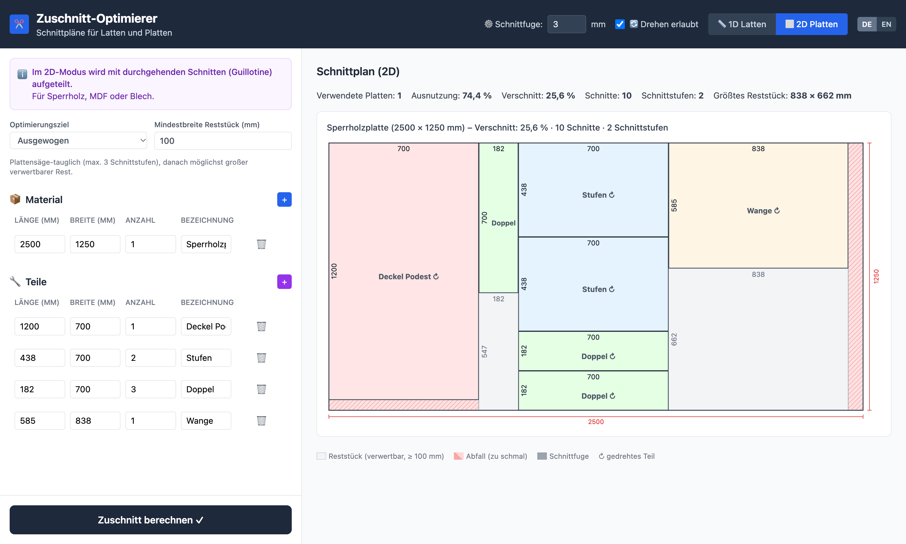
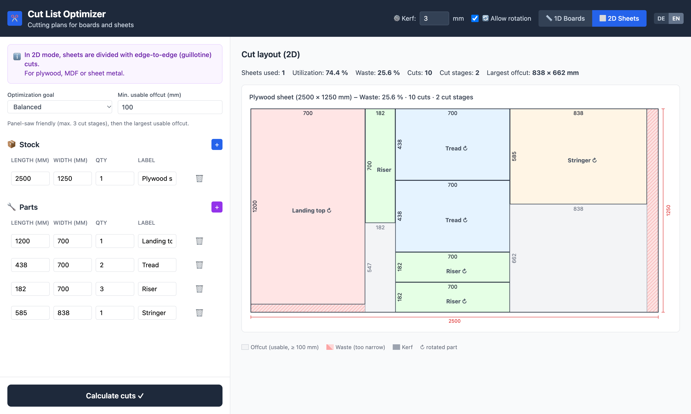

# Cutlist Optimiser

**[Deutsch](#deutsch)** · **[English](#english)**



---

## Deutsch

Ein Zuschnitt-Optimierer für Werkstatt und Holzbearbeitung, der komplett im Browser läuft.
Du gibst ein, welches Material du hast und welche Teile du daraus brauchst.
Die App berechnet einen Schnittplan mit möglichst wenig Verschnitt und zeigt ihn grafisch an.

Die App braucht kein Backend, keine Installation und keinen Build-Schritt.

### Funktionen

- **1D-Modus (Latten, Leisten, Rohre, Kanthölzer):** Teile werden nach Breite gruppiert und nur aus Material gleicher Breite geschnitten. Gepackt wird auf der Länge nach *Best-Fit-Decreasing*.
- **2D-Modus (Sperrholz, MDF, Blech):** *Guillotine-Packung*. Jeder Schnitt geht von Kante zu Kante, wie auf einer Formatkreissäge. Teile dürfen optional um 90° gedreht werden.
- **Wählbares Optimierungsziel (2D):** *Ausgewogen* (Plattensäge-tauglich, dann große Reste), *Einfach sägen* (wenige Schnittstufen und Schnitte) oder *Große Reste* (ein möglichst großes Reststück). Die Mindestbreite, ab der ein Rest als verwertbar gilt, ist einstellbar.
- **Iterative Optimierung (2D):** Die erste Lösung erscheint sofort. Danach sucht ein genetischer Algorithmus im Hintergrund weiter, gestartet mit mehreren Sortierstrategien und Packverfahren. Bei großen Aufträgen lässt er sich jederzeit stoppen. Das Ergebnis wird nie schlechter als die erste Lösung.
- **Schnittfuge (Kerf):** Die Sägeblattbreite wird zwischen den Teilen berücksichtigt, nicht an der Außenkante des Rohteils.
- **Mehrere Rohteilgrößen:** Pro Teil wird das passende Rohteil gewählt, unabhängig von der Eingabereihenfolge.
- **Nicht zuordenbare Teile:** Sie werden mit Grund aufgelistet, z. B. „zu groß“, „keine passende Breite“ oder „Material reicht nicht“.
- **Schnittplan:** Balken (1D) bzw. Plattenplan als SVG (2D). Im Plattenplan stehen die Maße an den Kanten der Teile und der verwertbaren Reste, Abfall ist schraffiert, die Gesamtmaße stehen außen. Dazu kommen Kennzahlen zu Ausnutzung, Verschnitt, Schnitten, Schnittstufen und größtem Reststück.
- **Deutsch und Englisch:** Die Sprache lässt sich oben rechts umschalten (DE/EN) und wird im Browser gespeichert.

### Benutzung

`index.html` im Browser öffnen, per Doppelklick oder so:

```bash
open index.html
```

Beim ersten Laden ist eine Internetverbindung nötig, weil React, Babel und Tailwind per CDN geladen werden. Alle Berechnungen laufen lokal im Browser. Es werden keine Daten verschickt.

1. Oben den Modus wählen: **1D Latten** oder **2D Platten**.
2. Die Schnittfuge in mm eintragen. Im 2D-Modus kannst du außerdem das Drehen von Teilen erlauben sowie Optimierungsziel und Mindestbreite für Reststücke wählen.
3. Unter **Material** das vorhandene Material und unter **Teile** die benötigten Teile eintragen: Länge, Breite, Anzahl und Bezeichnung.
4. Auf **Zuschnitt berechnen** klicken.

Alle Maße sind in Millimetern.

Optionale URL-Parameter, praktisch für Demos und Screenshots: `?lang=de|en` setzt die Sprache, `?mode=2d` startet im 2D-Modus, `?run=1` rechnet sofort nach dem Laden. Beispiel: `index.html?lang=en&mode=2d&run=1`.

### Projektstruktur

```
index.html                 Oberfläche (React 18 per CDN, In-Browser-Babel), Texte DE/EN, lädt optimizer.js
optimizer.js               Algorithmen ohne UI (läuft im Browser und in Node)
test/optimizer.test.js     Tests mit dem Node-eigenen Test-Runner
package.json               nur das Test-Skript, keine Abhängigkeiten
docs/
  PRODUCT_REQUIREMENTS.md  Produktspezifikation: Regeln, Akzeptanzkriterien, Release-Plan, Ideen
  images/                  Screenshots
```

`optimizer.js` stellt seine Funktionen im Browser als `window.CutlistOptimizer` bereit und in Node per `require('./optimizer.js')`:

- `solve1D(stock, parts, { kerf })` liefert `{ bins, unassigned }`.
- `solve2D(stock, parts, { kerf, allowRotation, goal, minOffcut })` liefert sofort die beste Startlösung.
- `createOptimizer2D(...)` sucht schrittweise weiter (`.step()`, für die Oberfläche), `optimize2D(...)` läuft in einem Durchgang.
- `packStrips` (Streifenpacker) und `pack2D` (freie Platzierung) sind die beiden Packverfahren. `analyzeSheet` rekonstruiert die Schnittfolge einer Platte (Schnittstufen, Schnitte, Reststücke).
- `metrics1D`, `metrics2D` und `compare2D(a, b, goal)` bewerten Ergebnisse. `GOALS` listet die Optimierungsziele.
- Konvention 2D: `x` läuft entlang der Plattenlänge, `y` entlang der Plattenbreite. Platzierte Teile tragen `{ x, y, w, h, rotated }`. Nicht zuordenbare Teile tragen einen sprachneutralen `reasonCode`.

### Tests

Voraussetzung ist Node.js 18 oder neuer. Es gibt keine npm-Abhängigkeiten.

```bash
npm test
```

Die Tests decken die gängigen 1D- und 2D-Fälle ab: Fuge, Breitengruppen, zu große Teile, fehlendes Material, mehrere Rohteilgrößen, Rotation, ungültige Eingaben, Schnittanalyse und Optimierungsziele. Hinzu kommen Zufallsfälle, die Invarianten prüfen:

- Kein Teil überlappt ein anderes, die Fuge eingerechnet.
- Alles bleibt innerhalb der Platte.
- Kein Teil geht verloren oder erscheint doppelt.
- Jeder Plan ist mit durchgehenden Schnitten sägbar.
- Die Optimierung ist nie schlechter als die erste Lösung.

### Bekannte Einschränkungen

- Kein Besäumen am Plattenrand, keine Faserrichtung und keine Schnittreihenfolge.
- Babel im Browser macht den ersten Start etwas langsamer.
- Nach geänderten Eingaben bleibt das alte Ergebnis stehen, bis neu berechnet wird.

Geplante Erweiterungen (z. B. Kostenberechnung, Restelager, CSV-Import/Export, Druckansicht, Zoll) stehen in [docs/PRODUCT_REQUIREMENTS.md](docs/PRODUCT_REQUIREMENTS.md).

---

## English



A cut list optimizer for workshops and woodworking that runs entirely in the browser.
Enter the stock you have and the parts you need.
The app calculates a cutting plan with as little waste as possible and draws it.

No backend, no installation and no build step.

### Features

- **1D mode (boards, mouldings, pipes, lumber):** parts are grouped by width and cut only from stock of the same width, packed along the length with *best fit decreasing*.
- **2D mode (plywood, MDF, sheet metal):** *guillotine packing*. Every cut runs edge to edge, as on a panel saw. Parts may optionally be rotated by 90°.
- **Selectable optimization goal (2D):** *Balanced* (panel-saw friendly, then large offcuts), *Simple cutting* (few cut stages and cuts) or *Large offcuts* (one offcut as large as possible). The minimum width for an offcut to count as usable is configurable.
- **Iterative optimization (2D):** the first solution appears immediately. A genetic algorithm then keeps searching in the background, seeded with several sort strategies and packing methods. It can be stopped at any time on large jobs, and the result never gets worse than the first solution.
- **Kerf:** the blade width is accounted for between parts, not at the outer edge of the stock.
- **Multiple stock sizes:** each part gets a fitting piece of stock, regardless of input order.
- **Unassigned parts:** listed with a reason, e.g. "too large", "no matching width" or "not enough stock".
- **Cut layout:** bars (1D) or an SVG sheet plan (2D). The sheet plan shows dimensions along the edges of parts and usable offcuts, waste is hatched, overall dimensions are drawn outside. Metrics include utilization, waste, cuts, cut stages and the largest offcut.
- **German and English:** switch the language at the top right (DE/EN). The choice is remembered in the browser.

### Usage

Open `index.html` in a browser, by double-clicking it or with:

```bash
open index.html
```

An internet connection is needed on first load because React, Babel and Tailwind come from a CDN. All calculations run locally in the browser. No data is sent anywhere.

1. Pick the mode at the top: **1D Boards** or **2D Sheets**.
2. Enter the kerf in mm. In 2D mode you can also allow rotation and choose the optimization goal and the minimum offcut width.
3. Enter your material under **Stock** and the parts you need under **Parts**: length, width, quantity and label.
4. Click **Calculate cuts**.

All dimensions are in millimetres.

Optional URL parameters, handy for demos and screenshots: `?lang=de|en` sets the language, `?mode=2d` starts in 2D mode, `?run=1` calculates right after loading. Example: `index.html?lang=en&mode=2d&run=1`.

### Project structure and tests

See the German section above for the file list and the `optimizer.js` API. Run the tests (Node.js 18+, no npm dependencies) with:

```bash
npm test
```

They cover the common 1D and 2D cases plus randomized invariant checks: no overlaps including kerf, everything inside the sheet, no part lost or duplicated, every layout guillotine-cuttable, and the optimizer never worse than the first solution.

Known limitations: no edge trimming, no grain direction and no cut sequence yet; in-browser Babel slows the first load; after changing inputs the old result stays until you recalculate.

The product specification ([docs/PRODUCT_REQUIREMENTS.md](docs/PRODUCT_REQUIREMENTS.md)) is written in German.

---

## Lizenz / License

[MIT](LICENSE)
